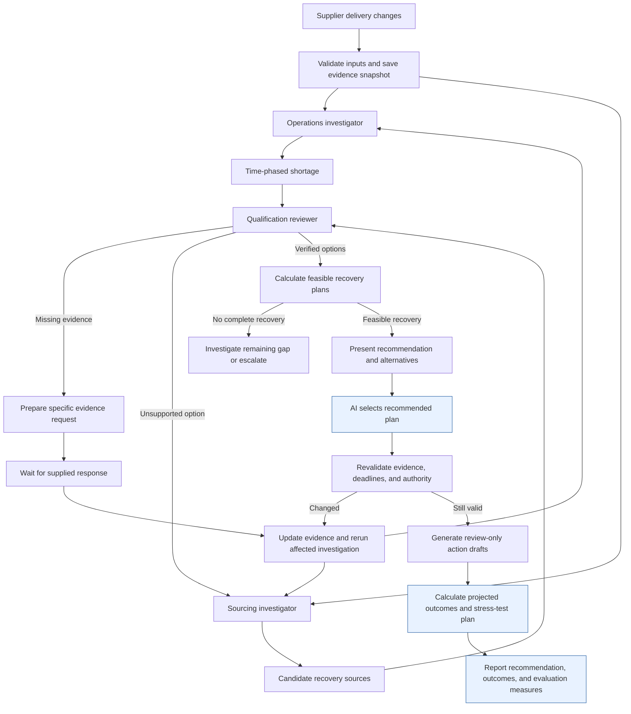

# Automatic recommendation and outcome evaluation

This augments the exact three-role diagram first supplied in response to "Can you give me the updated workflow?": Operations investigator, Sourcing investigator and Qualification reviewer. The later switch back to the older PDF's four roles was an incorrect change of reference. The existing investigation steps and evidence loop are preserved below. Only the benchmark's human selection is replaced by AI selection, and outcome calculation/reporting is appended. This is not an application change. No order, transfer, supplier message or customer promise is executed; the application's existing human checkpoint remains intact.

## Workflow

The original three roles, named intermediate outputs, qualification paths and evidence-refresh loop stay in place. Node N replaces human selection in this proposed benchmark only; Q and R are appended. Blue marks precisely those changes. Deterministic code calculates quantities, optimizes and simulates; the outcome engine is not another conversational agent. The recommendation includes selected actions, rejected alternatives, evidence versions, missing facts, cost, nominal schedule, sensitivity and reasons for selection. The original cost-first objective is unchanged.

Missing information does not become known because human review was removed. In this offline benchmark, a replay driver supplies dated fictional replies when available. In a deployed service, the workflow waits for a genuine authorized response or abstains. An evidence request is not permission to contact anyone. Stop on deadline/budget exhaustion or after at most three proposed-plan revisions; return the unresolved constraint if no supported plan qualifies. Do not force three revisions when the first plan qualifies.

Outcome evaluation has two distinct uses. Before selection, use declared stress assumptions that the planner may inspect. After selection, freeze the plan and evaluate held-out realization events that were not available to the planner. Outcome data may inform a later recommendation only after becoming observable; it cannot improve a recommendation retrospectively.

## Explicit selection policies

The initial case remains cost-first: protect all contracted dates using verified receipts, then minimize new expenditure, then excess drivers and supplier purchase count. Under that policy, recommend the $1,220 plan.

For a resilience-oriented demo, this extension proposes a separate policy:

1. Require all contracted dates to be feasible under the confirmed nominal receipts, and new recovery expenditure at or below $1,500.
2. Prefer the plan that preserves every contracted date in the largest number of the predeclared delay stress cases.
3. Break ties by lower expenditure, fewer excess drivers, then fewer supplier purchases.

This is a transparent business preference, not a new probability model or a hidden change to the original scenario. Its benchmark cap is an automatic recommendation constraint, not authority to spend. The evaluator enumerated all 23 nominally feasible plans within $1,500; this policy selects the existing Reserve fallback.

## Recommendation and calculated nominal outcomes

The default recommendation retains the original cost-first objective: transfer 40 drivers, buy 20 from Express and 60 from Standard for **$1,220**, with 150/150 robots on time if confirmed receipts hold. Report sensitivity beside this recommendation. Do not silently replace that objective with resilience maximization. The $1,480 option below is an alternative selected only under the separately declared resilience policy.

Under the resilience policy, recommend transferring 20 unallocated revision B drivers from Warehouse B and purchasing 100 approved revision B drivers from Reserve Supply. Both are confirmed usable Thursday November 5 at 08:00. New expenditure is $80 transfer charge plus $1,300 purchase and $100 freight, or **$1,480**. Supplier reservation expires Tuesday November 3 at 12:00; evidence must still be current when the recommendation is finalized.

Thursday starts 30 robots using 60 of the 120 recovered drivers. The remaining 60 support Friday's 30 starts. All five orders, totaling 150 robots, ship on their promised dates under the declared production assumptions. Without recovery, 90 of 150 robots ship on time. The improvement is 60 on-time robots, or 40 percentage points of on-time unit service. It is not an estimate of revenue or profit. The original $2,400 PO obligation remains separate.

| Plan | New expenditure | Nominal robots shipped on time | Whole orders shipped on time | Full recovery in stress grid |
| --- | ---: | ---: | ---: | ---: |
| No recovery | $0 | 90/150 | 3/5 | 0/16 |
| Minimum nominal cost: transfer 40, Express 20, Standard 60 | $1,220 | 150/150 | 5/5 | 2/16 |
| Resilience selection: transfer 20, Reserve 100 | $1,480 | 150/150 | 5/5 | 8/16 |

The resilience selection costs $260 more than the minimum-cost plan. Its nominal cost gap is $260/$1,220 = 21.31%; do not conceal this cost by scoring only favorable risk results. It is optimal under the declared coverage policy, not under the initial cost-first policy.

## What was actually evaluated

The standalone [offline evaluator](evaluate_outcomes.py) reads the supplied case and future confirmation fixtures. It calculates receipts, stock, production starts and promised-date service. The machine-readable output is [outcome_evaluation.json](outcome_evaluation.json). Run it with Python from this directory; it uses only the standard library and writes that output file. No application, model or Snowflake connection is involved.

Additional simulation assumptions are explicit: FIFO production by scheduled order, no early production, no overtime and no resequencing. A missed Thursday start can therefore consume Friday capacity when recovered. On-time units and whole orders are reported separately; partial production is not whole-order recovery.

The stress grid is all 16 combinations of four receipt sources (warehouse, Express, Standard and Reserve), each either on its confirmed day or one business day late. Use the same grid for every plan. A delay to an unused source has no effect. The primary PO remains November 9; other material and line capacity remain available. Expenditure is incurred as selected even if deliveries are delayed. No emergency purchase, penalty or refund is silently added.

Important individual outcomes:

- Warehouse one day late: minimum-cost plan ships 110/150 robots on time; resilience selection still ships 150/150. Its 100 Reserve drivers cover Thursday and leave 40, combined with the 20-unit Friday transfer, for Friday's 60-driver requirement.
- Express one day late: minimum-cost plan ships 130/150 robots on time. The resilience selection does not use Express.
- Standard one day late: minimum-cost plan ships 120/150 robots on time. The resilience selection does not use Standard.
- Reserve one day late: resilience selection ships 110/150 robots on time. It has concentrated risk in Reserve; it is not universally superior.
- All selected sources one day late: either recovery plan ships only 90/150 robots on time under FIFO. Neither plan guarantees full recovery.

The grid coverage scores (2/16 and 8/16) are exact descriptive results for this designed test set. They are **not** 12.5% and 50% estimated real-world recovery probabilities. The cases are not independent random observations, and unused-source dimensions repeat equivalent conditions for a particular plan. Do not attach a binomial confidence interval or statistical significance claim to this grid. Its purpose is sensitivity analysis.

This evaluation does not establish that an agent retrieved the evidence, that a model recommended the plan, or that multi-agent coordination outperforms a single agent. It establishes the consequences of the supplied candidate plans under the simulator's explicit assumptions.

## Model-backed evaluation to run next

[Public outcome validation](public-outcome-validation.md) explains which delivery outcomes are actually observed, which operational facts are missing, and why an unchosen sourcing action cannot be validated by copying another historical shipment's outcome.

Use the same dated evidence, tools, investigation deadlines, shared uncertainty draws and token/cost limits for a deterministic extraction/optimization pipeline, one agent, sequential specialists and concurrent specialists. Allow the single agent concurrent tool calls. A clairvoyant oracle is evaluator-only and is not a deployable baseline. Keep future evidence and oracle answers out of retrieval.

Start with reviewed scenario families and hold out entire families. Add independent supplier commitments, allocation errors, receipt ambiguity, exact-part conflicts, missing replies, expirations and later quantity changes. Template variants and repeated model seeds are correlated; do not report them as independent business cases.

Primary measures:

| Question | Measure |
| --- | --- |
| Did the workflow produce a supported decision? | Verified feasible recommendation rate; report justified abstentions separately on cases requiring them |
| Did the plan protect customers? | On-time units, whole-order on-time rate, and full-recovery rate under held-out realization events |
| Did recovery improve service? | Paired change in on-time units versus no recovery in the same realization |
| Was it economical? | New expenditure and cost regret versus an oracle with the same known facts and objective; infeasible plans remain failures |
| Were claims supported? | Unsupported commitment rate, source attribution, correct unknown handling and stale-evidence rejection |
| Did revision help? | Changed-fact detection, time to revised feasible recommendation, and improvement versus the same workflow with replanning disabled |
| Were multiple agents worthwhile? | Paired quality/service differences, cost, median/p95 latency and failure rate against the same-tool single agent |

For independently sampled business cases, report a 95% Wilson interval for binary rates; [NIST documents the method](https://www.itl.nist.gov/div898/handbook/prc/section2/prc241.htm). For architecture comparisons, use paired outcomes from the same cases. Bootstrap whole scenario families to obtain uncertainty intervals for mean service and expenditure differences; include repeated runs within their family rather than treating each as a new case. Report the number of families and cases, with uncertainty conditional on the benchmark. These intervals do not establish generalization to all supply chains.

A later arrival-risk model requires supplier/shipping-lane/order-size history: committed date, actual usable receipt, reserved versus received quantity, and the information available at decision time. Use temporal holdout, check probability calibration, preserve partial receipts, and model common disruptions jointly. Public catalog snapshots do not provide that history. Until such data is available, publish assumption-based stress coverage rather than a fabricated recovery probability. Thousands of simulated draws reduce numerical error under a chosen model; they do not validate its assumptions.

## Snowflake implementation boundary

Store versioned evidence, recommendations, available-at timestamps, simulator assumptions and later receipt/production events in distinct tables. SQL/Python implements feasibility, simulation and scoring. Claude role loops investigate and explain evidence; the application host enforces tool budgets and records state. CoCo can assist development and evaluation preparation; a signed-in CoCo session does not authenticate application SQL, Search or inference. Managed Cortex Agent orchestration is a separate integration choice. No cloud service was checked in this extension.

The proposed demo endpoint is an autonomous recommendation plus simulated outcome report. The existing production application remains review-only; changing its checkpoint is outside this research extension.
