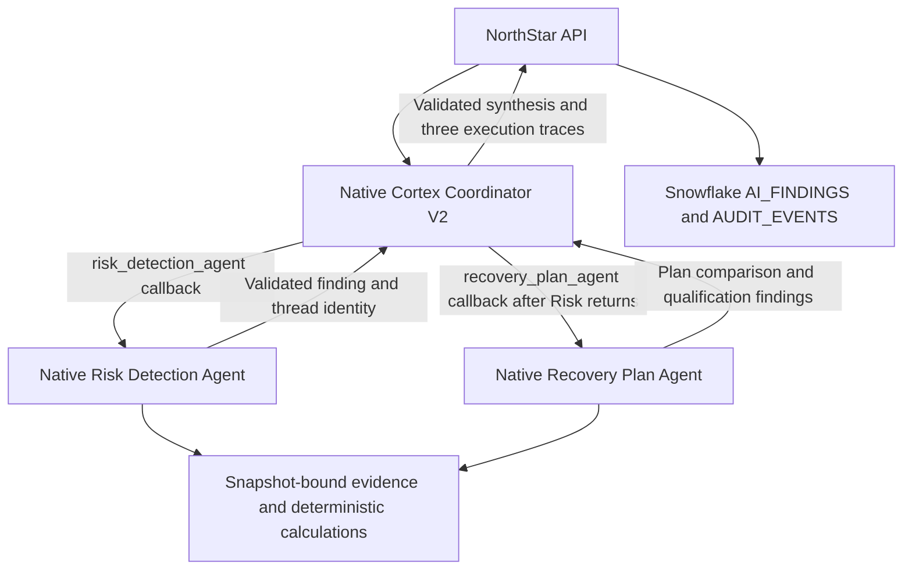

# NorthStar live workspace

The original Risk Inbox, six-step decision workflow, analysis tabs, comparison
table and Company Brain are connected to the NorthStar V2 data. The active
provider is Snowflake; connection failures return an error and never select a
local fixture or another model provider.

## Cloud data and state

`DEFAULT_DATABASE.NORTHSTAR_RECOVERY_V2` contains 25 typed `SOURCE_*` tables
with 205 records, five immutable `PUBLISHED_SNAPSHOTS`, ingestion metadata,
`CASE_STATE`, versioned `AI_FINDINGS` and `AUDIT_EVENTS`. Existing legacy schemas
and local checkpoints are preserved. The existing application role gets read
access to the evidence and scoped writes to case state, findings and audit.

Run these commands from `backend/` using the private existing `.env`:

```sh
# Validate locally; no cloud calls.
.venv/bin/python ../snowflake/load/northstar.py
# Idempotent typed-table upserts and snapshot publication; preserves case decisions.
.venv/bin/python ../snowflake/load/northstar.py --apply
# Verify every ingested row, runtime calculations and current-version findings.
.venv/bin/python ../snowflake/verify/northstar.py --live
# Explicitly run missing specialists and a Company Brain check.
.venv/bin/python ../snowflake/verify/northstar.py --live --investigate --chat
```

Runtime planning reads only cloud-published stages 0–4, starting at the complete
stage-4 evidence package. The full authoring catalog is used only by ingestion
and verification. Scripted approval/draft examples and monitoring rows are
stored separately from published planning evidence. They cannot approve a plan.
Monitoring must be explicitly admitted after the actual reviewer approves C.

Evidence hashes, scenario IDs, stage bounds and document dates are validated
before calculation or inference. Quantities and USD cents are integers. The
engine consumes the full BOM, respects one shared production line and two
business days to shipment, and allocates contracts before forecast. Offers and
reserved pilot stock are counted only in selected hypothetical plans. R&D stock
requiring inspection is excluded.

A real reviewer decision binds the exact fingerprint and scenario version,
checks the $250,000 recovery limit, and atomically updates cloud case state and
its audit trail using a revision predicate. Drafts stay unsent. No external
purchase, email, stock movement or customer commitment is executed. This is a
synthetic recovery case with live cloud I/O; dates remain the evidence's scenario
dates, not the wall clock. The original $164,800 PO is tracked separately.

## Claude analysis providers

The default `cortex_agent` provider uses the native coordinator and two
specialists described below. `PROJECT_NORTHSTAR_AI_PROVIDER=ai_complete`
explicitly selects the former direct-call provider: Operations, Sourcing,
Qualification and Company Brain call Snowflake `AI_COMPLETE` with the configured
Claude model and scoped cloud evidence. Neither provider claims Cortex Search
or Cortex Analyst execution. Provider failures never select the other provider.

The prompt excludes duplicate email bodies and authoring-only tables. The
structured citation schema enumerates only documents in the current snapshot.
The app checks returned citations, rejects unsupported currency amounts and blanket
forecast claims, and keeps model text advisory: deterministic
calculations own spending, schedules, inventory and approval eligibility.
Findings retain model, execution IDs, token usage, snapshot and prompt version in
Snowflake. A prompt change invalidates older cached findings. Completed reviews
survive another specialist failing; rerunning invokes only missing reviews.

`PROJECT_NORTHSTAR_MAX_COMPLETION_TOKENS` defaults to 1200, bounded to 256–4096.
The previous general 512-token cap truncated some structured specialist responses;
the NorthStar output setting is separate. No automatic paid retry is performed. The recorded
[live verification](northstar-live-verification.json) includes source-row equality,
three specialist query IDs, a Company Brain query, and a rolled-back live draft
transaction that leaves the user case unchanged.
See the official [AI_COMPLETE reference](https://docs.snowflake.com/en/sql-reference/functions/ai_complete-single-string)
and [structured-output contract](https://docs.snowflake.com/en/sql-reference/functions/ai_complete-structured-outputs).

## API and local verification

- `GET /api/northstar/case`: cloud case, evidence, calculations and current findings.
- `POST /api/northstar/case`: `revision`, `snapshot_id`, `action`; approval adds
  `actor`, `reason` and `plan_id`. Supported actions: `approve`, `monitor`, and
  stage `advance` when a case is at an earlier planning stage.
- `POST /api/northstar/investigate`: current `revision` and `snapshot_id`.
- `POST /api/northstar/chat`: the same binding plus `question`.

Stale bindings return 409. Cloud/model failures return 503. The frontend exposes
actual provider state and per-request failures; it never relabels a local case live.

`PROJECT_NORTHSTAR_MODE=offline` explicitly selects the isolated local provider
for development and regression tests only. It uses the same deterministic engine
and is not a fallback. The default is `live`.

Backend tests cover cloud corruption/missing evidence, future rows, citation
allowlists, deduplicated context, partial inference failures, atomic cloud
approval and competing writers, alongside the existing engine/security suite.
The HTTP restart test uses explicit offline test configuration. No credentials
or model calls are required for unit tests.

The frontend is `frontend/src/NorthStar.jsx` and reuses the original UI primitives
and styles. Run `bash scripts/dev.sh` from the repository root; open
[the local workspace](http://127.0.0.1:5173). The API uses `backend/.env` and the
existing `VITE_API_URL` support is preserved. Hosting must configure Snowflake
credentials privately in the backend; local verification does not deploy them.

## Native Cortex agent team (active and live verified)

`PROJECT_NORTHSTAR_AI_PROVIDER=cortex_agent` selects three named managed objects
in `DEFAULT_DATABASE.NORTHSTAR_RECOVERY_V2`:

| Object | Responsibility | Registered tools |
| --- | --- | --- |
| `SUMO_NORTHSTAR_ORCHESTRATOR_V2` | Delegate, sequence and synthesize | `risk_detection_agent`, `recovery_plan_agent` |
| `SUMO_NORTHSTAR_RISK_DETECTION_V1` | Review supplier delay, shortages, customer risk and exposure | `read_evidence`, `operations_analysis` |
| `SUMO_NORTHSTAR_RECOVERY_PLAN_V1` | Compare plans and review qualification, spending and forecast outcomes | `read_evidence`, `recovery_options`, `qualification_review` |



The coordinator decides delegation through Cortex Agent Run tool requests.
Python validates each request and implements the two generic delegation callbacks
by invoking the corresponding **named Cortex Agent object**, with its own thread
and tools. This is application-mediated agent-to-agent delegation, not three
AI_COMPLETE calls or a static Python specialist thread pool. Snowflake's
`agent_toolset` feature expands tools into a caller's toolset and does not itself
invoke a separate specialist; this implementation intentionally uses actual
child Agent Run requests instead.

Risk Detection must complete its evidence and operations tools before its result
can reach Recovery Plan. The Recovery Plan agent receives that validated risk
review and exact snapshot identity, then retrieves recovery options and dated
evidence before qualification. All three agents must complete their required
tools. Unknown tools, repeated calls, altered scopes, recursive delegation and
out-of-order requests fail closed. Citation, response-shape, 90-word length and
currency validation runs **before child findings reach the coordinator**. The
coordinator can cite only the source IDs in the specialists' accepted findings.

Both investigation and Company Brain use this full delegation flow. For an
investigation, the existing API shape is preserved: `operations` contains the
Risk Detection agent's actual output; `sourcing` and `qualification` contain the
Recovery Plan agent's actual outputs. The coordinator's separate synthesis is
stored in execution metadata. Its prose never replaces the specialists' saved
findings. All three sections are admitted transactionally after validation.
Each finding has `agent_execution` for its producer plus `execution` for the
coordinator and its two child traces. The frontend names the roles and links to
the producing agent and coordinator in Snowflake.

Snowflake stores all evidence, findings, native request receipts and activity.
`AUDIT_EVENTS` includes `delegated_agent_completed` for each child and
`agent_review_completed` for the coordinator. Agent/thread/run/message IDs and
tool calls are recorded; they can be correlated with each named object's
Observability history. Client callbacks require the app runtime; Agent Studio
playground alone cannot execute them. This does not add an autonomous account-wide
risk monitor, Cortex Search or Analyst, arbitrary SQL, or write/action tools.
Python's existing engine still owns numerical planning and approval eligibility.

Each agent is limited to eight Agent Run requests, with a shared ceiling of 24
requests and a 240-second application deadline checked before requests across
the team. Each server request has a 60-second/8,000-token orchestration budget.
Completed thread/response receipts replay after interruption without repeating
paid calls. An uncertain call blocks replay until operator inspection. Child
failures do not fall back to AI_COMPLETE or silently produce partial findings.
Use one backend worker and one writer deployment per audit namespace.

Generic client-tool results can be replaced by orphan markers in Snowflake's
thread history. Each continuation carries all completed, validated results as
explicitly marked data, plus the remaining tool names or final-answer contract.
This restores context without executing callbacks again. Risk Detection receives
a baseline-only assignment and excludes recovery-option facts from its operations
tool. The 90-word validator excludes standalone punctuation.

The active default is `cortex_agent`. The native cache namespace is `northstar-multi-agent-v3`, isolated
from both the older single-coordinator cache and direct-completion findings.
No earlier AI_COMPLETE verification establishes acceptance for these agents.

Review the exact [three proposed objects and grants](../snowflake/proposed/northstar-agent.sql).
The versioned V2 coordinator preserves the former V1 object, if present.
Render locally without cloud calls:

```sh
cd backend
.venv/bin/python ../snowflake/load/agents.py --northstar
# After explicit approval of the three objects and grants to PROJECT_RECOVERY_APP_V1:
.venv/bin/python ../snowflake/load/agents.py --northstar --apply
# Review an in-place specification update, preserving object history and grants:
.venv/bin/python ../snowflake/load/agents.py --northstar --update
# Apply the reviewed update:
.venv/bin/python ../snowflake/load/agents.py --northstar --update --apply
```

The [provisioning record](northstar-agent-provisioning.json) verifies all three
cloud specifications and their USAGE/MONITOR grants to PROJECT_RECOVERY_APP_V1.
The [live acceptance record](northstar-agent-live-verification.json) verifies
all 205 source rows across 25 tables, a complete native investigation, and a
Company Brain answer about the $250,000 recovery budget. Both flows used three
distinct threads, eight Agent Run requests and all seven registered tool calls.
Every execution trace matched its persisted Snowflake audit record; case
revision, evidence, decisions and drafts were unchanged. The investigation
findings and chat answer remain in Snowflake.

The [HTTP smoke-test record](northstar-agent-http-verification.json) confirms
the restarted local API returned 200 for case reads, investigation and chat with
`ai_provider=cortex_agent`. It reused the verified threads without new inference
and preserved the case state. Browser checks confirmed the native findings,
producing-agent identities and Snowflake links render. All 214 backend tests,
the nine source-pack tests, 3,437 source checks and the frontend build passed.

Activation corrected an unsupported ToolInputSchema field, an overly broad risk
assignment, lost historical client-tool results, and punctuation counted as
words. Failed earlier attempts remain in their original audit namespaces. Their
receipts were never silently retried. Completed current-version requests replay
without new inference, including the final validation correction.

Run acceptance with the active provider:

```sh
cd backend
.venv/bin/python ../snowflake/verify/northstar.py --live --investigate --chat \
  --output ../docs/northstar-agent-live-verification.json
```

`IF NOT EXISTS` does not update existing specifications. Render and review
`--update` before applying an intentional specification change. Hosting must
use this code and `PROJECT_NORTHSTAR_AI_PROVIDER=cortex_agent`; the local API
was restarted with that setting. This activation does not deploy the app to
Render or Vercel.

Official contracts: [CREATE AGENT](https://docs.snowflake.com/en/sql-reference/sql/create-agent),
[Agent Run API](https://docs.snowflake.com/en/user-guide/snowflake-cortex/cortex-agents-run),
[Agent toolsets](https://docs.snowflake.com/en/user-guide/snowflake-cortex/cortex-agents-toolsets).
